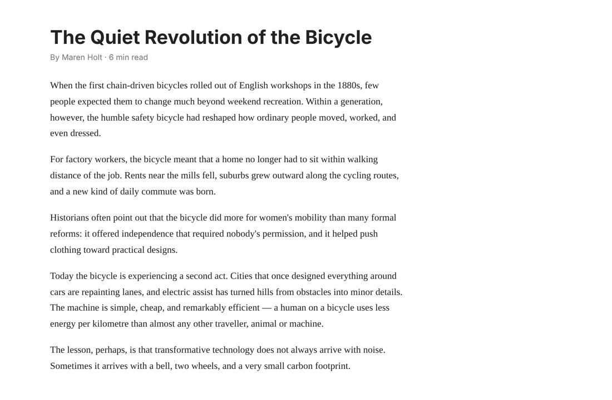

# Page Ask

[](LICENSE)


**English** · [Türkçe](README.tr.md)

> Ask Gemini about the page you're on — a Vivaldi/Chromium extension.

Page Ask is the Vivaldi equivalent of Google's "Ask Gemini about this page" feature. Press **Alt+G** (or click the toolbar icon) and a floating chat panel opens over the page. Ask anything about what you're reading: the full text of the page is sent to Gemini along with your question. It was written for Vivaldi, uses Manifest V3 and also works in Chrome and other Chromium browsers.

It was built because Vivaldi has no built-in "ask AI about this page" feature, and because the free Gemini API tier is generous enough for everyday use with your own key. Nothing runs on a server of mine: the extension talks directly to Google's API.



## Features

- Floating chat panel opened with the toolbar icon or **Alt+G** (changeable at `vivaldi://extensions/shortcuts`).
- **Pinned by default.** With the pin off, the panel closes when you click outside it. Open/close animation, draggable by its header, position is remembered.
- The **whole page** is sent, untrimmed. Only the cap in settings applies (default 2,000,000 characters).
- **Selected text** on the page is attached to your question as "selected text".
- Page info bar above the chat: page title, character/token estimate and the token count of the last request. Can be turned off in settings.
- **Streaming** answers. Markdown is rendered safely (raw HTML is escaped).
- Chat history lives **in memory for the session only** and is never written to disk.
- Header buttons: new chat (re-reads the page), settings, pin, close.
- Turkish and English UI (defaults to the browser language).
- On pages where extensions can't run (`vivaldi://`, `chrome://`, store pages, the PDF viewer) a small notice pops up under the toolbar icon for 2 seconds. No extra window is opened.


## Installation

You need Vivaldi (or Chrome/another Chromium browser, version 111+) and a free Gemini API key.

### 1. Get the extension

Download the repository as a ZIP (**Code → Download ZIP**) and extract it somewhere permanent, or clone it:

```bash
git clone https://github.com/<your-username>/page-ask.git
```

Don't move or delete the folder afterwards, or the extension will disappear.


### 2. Turn on Developer mode

Open `vivaldi://extensions` and switch on **Developer mode** (top right).


### 3. Load the extension

Click **Load unpacked** and select the `page-ask` folder (the one that contains `manifest.json`).


### 4. Get a Gemini API key

Create a key at <https://aistudio.google.com/apikey>.


### 5. Paste the key into the settings

Right-click the extension icon → **Options** (or use the settings button in the panel), paste the key and press **Save**.


### 6. Pin it to the toolbar

Click the puzzle icon in the toolbar and pin **Page Ask**.


### 7. Try it

Open any web page and press **Alt+G**.

## Usage

- **Alt+G** or the toolbar icon opens/closes the panel. **Esc** closes it.
- While the pin is on (default) you can click around the page and select text; the selection appears in the panel and is sent with your next question.
- Drag the panel by its header to move it.
- The **new chat** button starts over and re-reads the page, e.g. after the page changed.
- On unsupported pages you'll see this notice:


## Settings


| Setting | Description |
| --- | --- |
| Gemini API key | Your key from Google AI Studio. |
| Model | **List models** shows only the Flash / Flash-Lite / Pro groups your key can use. Image, audio, embedding, omni and 2.5 models closed to new users are hidden. Default: `gemini-3.5-flash-lite`. |
| Language | Türkçe or English (custom dropdown). Default: browser language. |
| Show info bar | Show or hide the page info bar. |
| Clear chat when panel closes | Delete the conversation whenever the panel is closed. |
| Maximum page characters | Upper limit for page text. Default 2,000,000. |
| Shortcut | Shortcut to the browser's shortcut settings. |

## Privacy and permissions

- The page text and your questions go **straight to Google's Gemini API**. On the free tier, Google may use submitted content to improve its products, so avoid sensitive pages (banking, email).
- The API key is stored in `chrome.storage.local` and is only used by the service worker. It is never exposed to web pages.
- Chat history is kept in memory only and is not written to disk.
- No persistent "access all sites" permission. The panel is injected only when you press the icon or shortcut.

| Permission | Why |
| --- | --- |
| `activeTab`, `scripting` | Inject the panel into the current tab when you activate the extension. |
| `storage` | Save your settings. |
| `tabs` | Only to look at the URL scheme of the tab, so restricted pages like `vivaldi://` can show the notice. Other tabs' content is never read. |
| host: `https://generativelanguage.googleapis.com/*` | Call the Gemini API. |

## How it works

- **Manifest V3.** The service worker is `background.js`; `content.js` is the content script. The panel is drawn inside a **Shadow DOM** so the page's CSS can't interfere. `md.js` renders Markdown, `i18n.js` holds the translations.
- The content script is injected with `chrome.scripting.executeScript` only when you press the icon or shortcut (`activeTab`).
- Request: `POST v1beta/models/{model}:streamGenerateContent?alt=sse` with the `x-goog-api-key` header. The page text goes into the first user message (friendly to implicit caching). The system instruction is in English.
- Designed for the free Gemini API tier. Limits vary per model; see your [AI Studio rate limits](https://aistudio.google.com/rate-limit). The page is resent with each question, so very long pages use up quota quickly (HTTP 429).

### File structure

```
page-ask/
├── manifest.json     # Extension manifest (MV3)
├── background.js     # Service worker: Gemini requests, injection, key handling
├── content.js        # Panel UI (Shadow DOM), page text capture
├── md.js             # Safe Markdown renderer
├── i18n.js           # Turkish/English strings
├── notice.html       # Popup for pages the extension can't open
├── notice.js
├── options.html      # Settings page
├── options.js
├── icons/            # Extension icons
├── _locales/         # Manifest strings (en, tr)
├── docs/images/      # README images
├── README.md
├── README.tr.md
└── LICENSE
```

## Troubleshooting

- **"Model not found" error:** new API keys can't access the Gemini 2.5 models any more. Open Settings → **List models** and pick a model your account can use.
- **429 / quota errors:** you hit the free tier limit. Wait a minute, use a lighter model such as Flash-Lite, or try a shorter page.
- **Nothing happens on a page:** browser-internal pages, store pages and the PDF viewer are not supported (you'll see the notice).
- **Shortcut doesn't work:** another extension may use Alt+G. Change it at `vivaldi://extensions/shortcuts`.
- **Extension disappeared:** the folder was moved or deleted. Load it again via **Load unpacked**.

## Contributing

Issues and pull requests are welcome. Please keep changes focused and describe how you tested them (load the folder unpacked, try a normal page and a restricted page).

## License

[MIT](LICENSE) © 2026 Alp Oral
